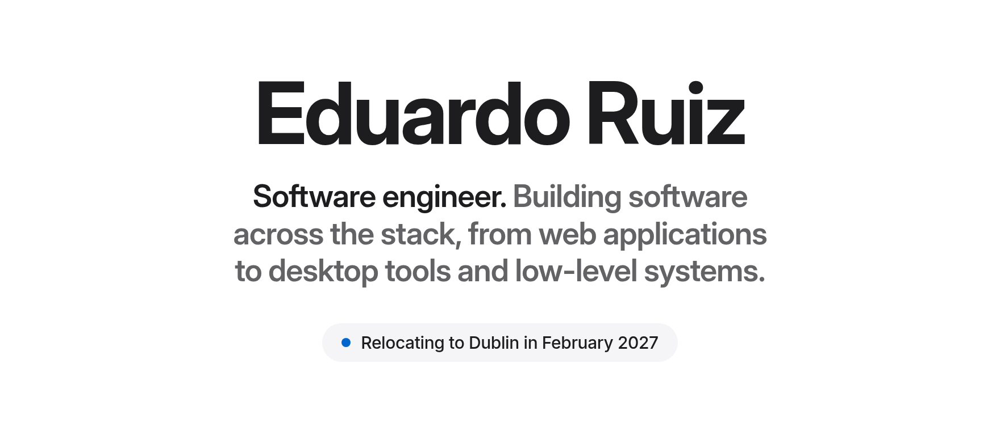
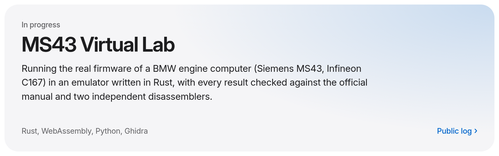
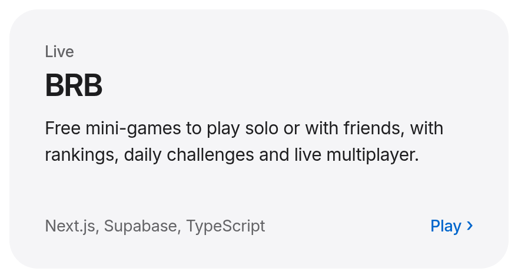
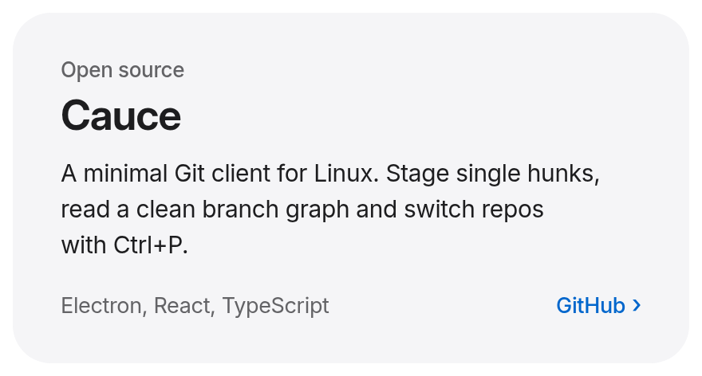
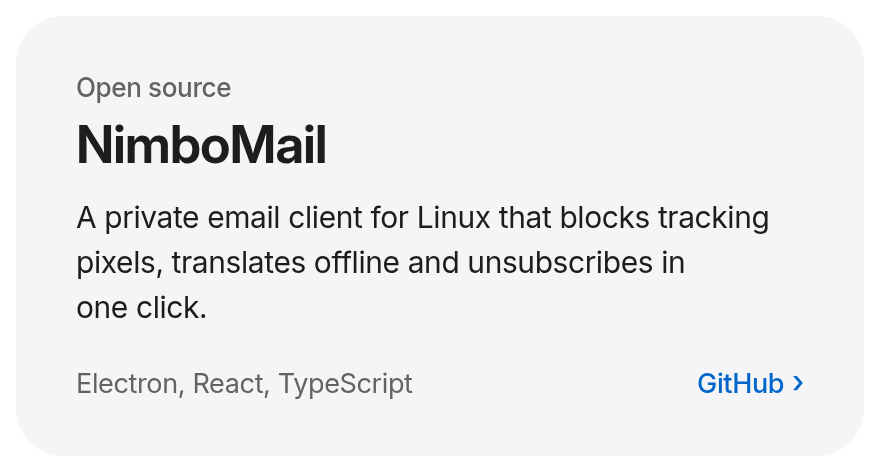
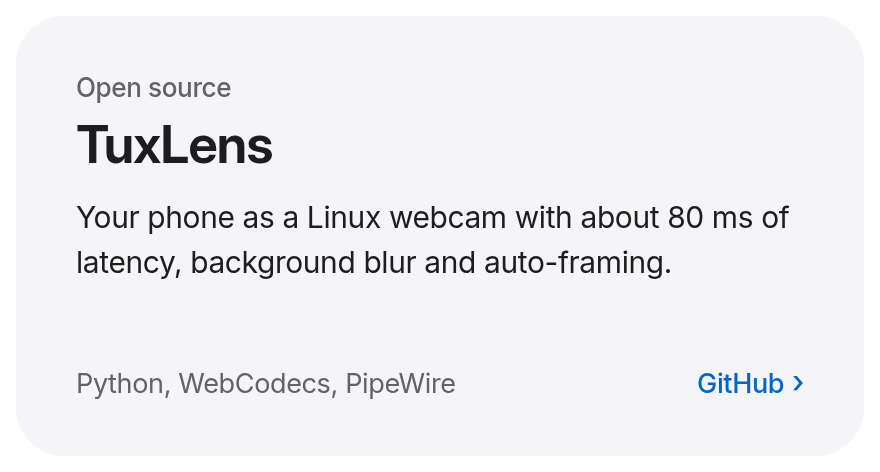
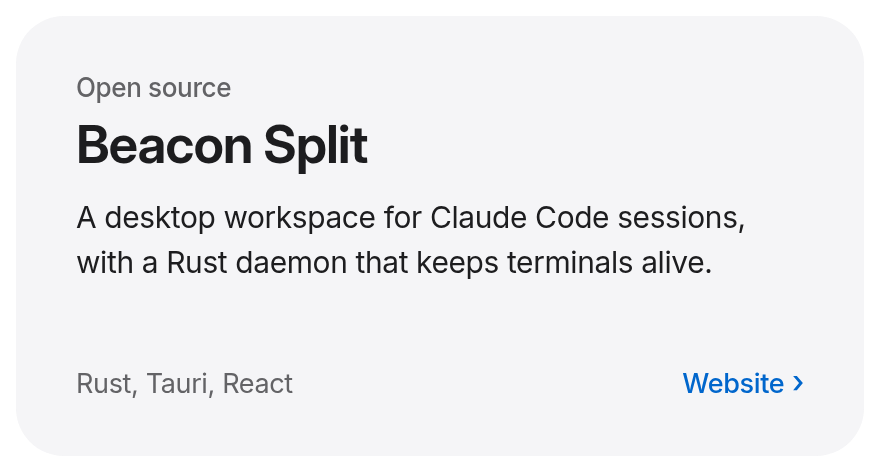
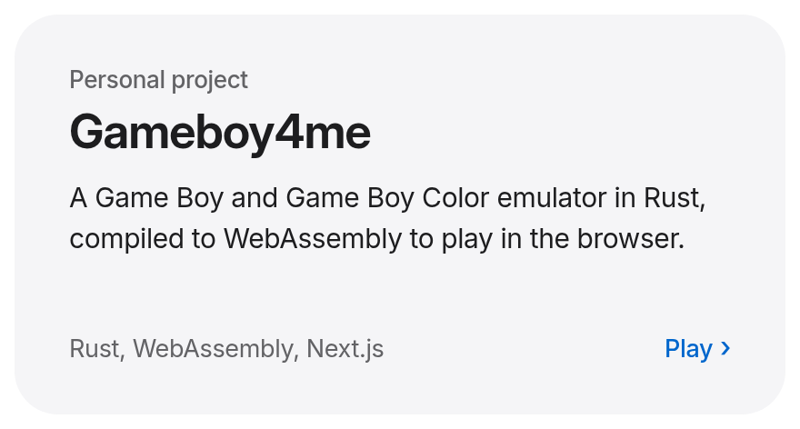

  <a href="https://edu-ruiz-portfolio.vercel.app/">
    <picture>
      <source media="(prefers-color-scheme: dark)" srcset="./assets/hero-dark.png">
      
    </picture>
  </a>

  <a href="https://edu-ruiz-portfolio.vercel.app/">Portfolio</a>&nbsp;&nbsp;·&nbsp;&nbsp;<a href="https://www.linkedin.com/in/edu-ruiz-cantos/">LinkedIn</a>&nbsp;&nbsp;·&nbsp;&nbsp;<a href="mailto:ruizcantosps@gmail.com">Email</a>&nbsp;&nbsp;·&nbsp;&nbsp;<a href="https://x.com/_hxst">X</a>

 

  <a href="https://ms43-virtual-lab-logs.vercel.app/"><picture><source media="(prefers-color-scheme: dark)" srcset="./assets/ms43-dark.png"></picture></a>
  <a href="https://afk-brb.vercel.app/"><picture><source media="(prefers-color-scheme: dark)" srcset="./assets/brb-dark.png"></picture></a><a href="https://github.com/hxst1/Cauce"><picture><source media="(prefers-color-scheme: dark)" srcset="./assets/cauce-dark.png"></picture></a>
  <a href="https://github.com/hxst1/NimboMail"><picture><source media="(prefers-color-scheme: dark)" srcset="./assets/nimbomail-dark.png"></picture></a><a href="https://github.com/hxst1/TuxLens"><picture><source media="(prefers-color-scheme: dark)" srcset="./assets/tuxlens-dark.png"></picture></a>
  <a href="https://beacon-split.com"><picture><source media="(prefers-color-scheme: dark)" srcset="./assets/beacon-split-dark.png"></picture></a><a href="https://gameboy4me.vercel.app"><picture><source media="(prefers-color-scheme: dark)" srcset="./assets/gameboy4me-dark.png"></picture></a>

 

  Software engineer at Medios y Proyectos, building the web for Red Bull. TypeScript, React, Next.js, Node.js, Ruby on Rails, Rust.

